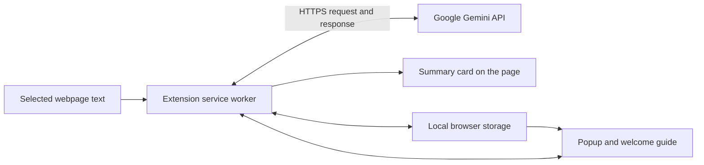

# Select Summary

Select Summary is a Chrome extension that summarizes text you select on a webpage using your own Gemini API key. It shows the summary on the page and keeps saved summaries and activity on your device.

## Tech Stack

- JavaScript, HTML and CSS
- Chrome Extension APIs (Manifest V3)
- Chrome local and session storage
- Google Gemini REST API

## How to Run It

You can install Select Summary from the [Chrome Web Store](https://chromewebstore.google.com/detail/select-summary/cmhemijfkgdmehimocompddmibmbndfd) by choosing **Add to Chrome**.

*The store version may be older than this repository's version (3.0.0). Check the version under the listing's Details before installing; follow the local steps below if you need this source version.*

You need Chrome 127 or newer and a Gemini API key with access to the configured model, `gemini-3.5-flash-lite`.

```sh
git clone https://github.com/DevPatel5061/select-summary.git
cd select-summary
```

There are no dependencies to install, build commands or local servers to start.

1. Open `chrome://extensions` and turn on **Developer mode**.
2. Click **Load unpacked** and select the **`chrome-extension`** folder.
3. In the welcome guide, connect your Gemini API key and summarize some practice text to complete setup.
4. On a webpage, select text, right-click and choose **Summarize selection**. You can also press **Alt + Shift + S** (Option + Shift + S on Mac).
5. Click the extension icon to view activity, saved history and settings. History can keep 5, 10, 15 or 20 summaries; the default is 10.

Change keyboard shortcuts at `chrome://extensions/shortcuts`. After editing the code, reload the extension at `chrome://extensions` and refresh the webpage.

## Project Structure

- `chrome-extension/manifest.json` defines permissions, keyboard commands and entry points.
- `background.js`, `gemini.js`, `core.js` and `storage.js` handle requests, validation and saved data inside `chrome-extension/`.
- `popup.*`, `interface.html` and `bootstrap.js` provide the dashboard; `welcome.*`, `walkthroughs.js` and the demo files provide onboarding.
- `content.js`, `summary-card.js` and `summary.css` display summaries on webpages and in onboarding.
- `chrome-extension/shared/` contains reusable behavior; `chrome-extension/icon/` contains the required logos.

## How It Works



The extension has no backend server of its own. Its service worker receives selection requests, checks the input and sends the selected text directly to Gemini through `gemini.js`. It saves successful results before passing them to the summary card. The popup reads saved history and activity through the worker.

The API key and history stay in local extension storage, which is not encrypted by the extension. Selected text is sent to Google, and summaries may contain information from that text. Connecting a key sends one small validation request; each summary sends one generation request without automatic retries.

Protected browser pages can block selection access or summary cards. If a result is saved but cannot appear on the page, it remains available in History.
