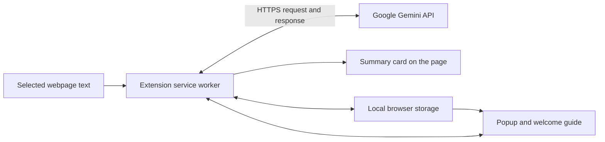

# Select Summary

Select Summary is a Chrome extension that summarizes text you select on a webpage using your own Gemini API key. It shows the summary on the page and keeps saved summaries and activity on your device.


## Problem

Reading articles can take anywhere from 1 to 10 minutes depending on the length and details of the article. A large majority of the time, they are filled with irrelevant information that is not important to us.

The only options were to: read it, leave it or copy and paste it into AI and ask it to summarize it, then ask it to condense, just to get your desired output. What if there was a simple solution?

Select Summary uses Gemini with specific, custom instructions to ensure it provides the main idea of the content without the extra fluff. The summary is showed in a simple, non-intrusive manner on your screen, 
and everything is saved locally on your browser.


## Tech Stack

- JavaScript, HTML and CSS
- Chrome Extension APIs (Manifest V3)
- Chrome local and session storage
- Google Gemini REST API

## How to Run It

**Recommended:**

You can install Select Summary from the [Chrome Web Store](https://chromewebstore.google.com/detail/select-summary/cmhemijfkgdmehimocompddmibmbndfd) by choosing **Add to Chrome**.
You need Chrome 127 or newer and a Gemini API key with access to the configured model, `gemini-3.5-flash-lite`.

**Alternate:**
1. Clone the repositories
```sh
git clone https://github.com/DevPatel5061/select-summary.git
cd select-summary
```
2. Open `chrome://extensions` and turn on **Developer mode**.
3. Click **Load unpacked** and select the **`chrome-extension`** folder.
4. In the welcome guide, connect your Gemini API key and summarize some practice text to complete setup.
5. On a webpage, select text, right-click and choose **Summarize selection**. You can also press **⌥ + ⇧ + S** (Alt + ⇧ + S).
6. Click the extension icon to view activity, saved history and settings.

## Project Structure
```
├── chrome-extension/
│   ├── icon/
│   │   ├── icon.png
│   │   └── onboarding.svg
│   ├── shared/
│   │   ├── client.js
│   │   ├── key-field.js
│   │   ├── refresh.js
│   │   ├── theme-page.js
│   │   ├── theme.js
│   │   └── timeline.js
│   ├── article-demo.js
│   ├── background.js
│   ├── bootstrap.js
│   ├── content.js
│   ├── core.js
│   ├── demo-articles.js
│   ├── gemini.js
│   ├── icons.js
│   ├── interface.html
│   ├── manifest.json
│   ├── popup.css
│   ├── popup.html
│   ├── popup.js
│   ├── shortcuts.js
│   ├── storage.js
│   ├── summary-card.js
│   ├── summary.css
│   ├── theme.css
│   ├── walkthroughs.js
│   ├── welcome.css
│   ├── welcome.html
│   └── welcome.js
├── .gitignore
├── CHANGELOG.md
├── LICENSE
└── README.md
```
- `manifest.json` defines permissions, keyboard commands and entry points.
- `background.js`, `gemini.js`, `core.js` and `storage.js` handle requests, validation and saved data inside `chrome-extension/`.
- `popup.*`, `interface.html` and `bootstrap.js` provide the dashboard; `welcome.*`, `walkthroughs.js` and the demo files provide onboarding.
- `content.js`, `summary-card.js` and `summary.css` display summaries on webpages and in onboarding.
- `chrome-extension/shared/` contains reusable behavior; `chrome-extension/icon/` contains the required logos.

To be noted: The codebase is actively being refactored for optimal structure and efficiency. 

## How It Works



The extension uses service worker to receives selection requests, checks the input and sends the selected text directly to Gemini through `gemini.js`. It saves successful results before passing them to the summary card. The popup reads saved history and activity through the worker. Protected browser pages can block selection access or summary cards. If a result is saved but cannot appear on the page, it remains available in History.

Connecting a key sends one small validation request and the API key and history stay in local extension storage.
