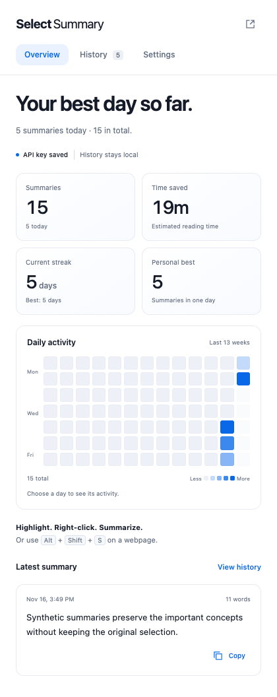
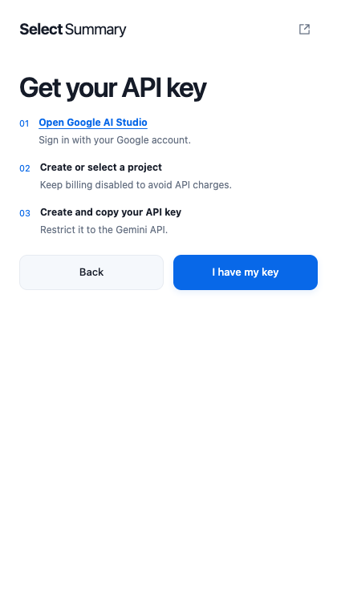

# Select Summary

**Summarize highlighted text with Gemini.**

A Manifest V3 Chrome extension that turns highlighted text into a concise Gemini summary. Bring your own API key, keep recent summaries locally, and see your reading activity without extension tracking.

**Version 3.0.0 is a source update.** The [Chrome Web Store listing](https://chromewebstore.google.com/detail/select-summary/cmhemijfkgdmehimocompddmibmbndfd) may contain an earlier release until a new package is published.

## Features

- Plain-text summaries targeting 15–30 words (35 maximum), shorter for short selections.
- Immediate API key setup followed by required local practice of right-click and keyboard summarization.
- In-page results and a local history of the latest 10 summaries.
- Daily activity, estimated reading time saved, streaks, and personal bests.
- Responsive toolbar popup and resizable window, keyboard access, and reduced-motion support.
- Blue, black, and white styling, local system fonts, and original button icons.

| Overview | First-time setup |
| --- | --- |
|  |  |

Screenshots use synthetic data. See the [required practice walkthrough](docs/images/tutorial.png). The activity chart is a local feature, not developer analytics.

## Install from this repository

No Node.js or build step is needed to load the extension.

1. Download **Code → Download ZIP** and extract it, or clone the repository:

   ```sh
   git clone https://github.com/DevPatel5061/select-summary.git
   cd select-summary
   ```

2. Open `chrome://extensions` and enable **Developer mode**.
3. Choose **Load unpacked** and select the **`chrome-extension` folder**, not the repository root.
4. Open the browser's Extensions menu and pin **Select Summary**.
5. Open the extension and follow the connection steps below.

Use Chrome 127 or newer. Compatible Chromium browsers may work, but shortcut handling, protected pages, and popup presentation vary. Firefox and Safari packages are not included.

## Connect Gemini

1. Open [Google AI Studio's API key page](https://aistudio.google.com/apikey) and sign in.
2. Create or select a project. Use a project **without billing enabled** to avoid API charges; Google controls free-tier eligibility and quotas.
3. Create a key restricted to the Gemini API and copy it.
4. Return to the extension, choose **I have my key**, and paste it into the masked field.
5. Read and accept the Google data notice, then select **Save key**. The key is saved immediately without an API test call.
6. Complete both practice steps: highlight the paragraph and use the right-click menu, then highlight again and use your assigned shortcut. This walkthrough runs locally and does not count toward history or activity.

The setup step is remembered if the popup closes while visiting AI Studio. Unsaved keys are not persisted. Replace a key in **Settings**. Key access is checked when you request your first real summary, not during setup.

**The extension has no fees, advertising, analytics, or developer-run backend.** Gemini is a separate service: selected text goes to Google, free-tier content may be used for product improvement and human review, and billing-enabled projects may incur charges. The extension cannot verify project billing status. Avoid sensitive text. Read [Privacy and data handling](PRIVACY.md), [Google's terms](https://ai.google.dev/gemini-api/terms), and [API pricing](https://ai.google.dev/gemini-api/docs/pricing).

## Use it

1. Highlight text on a regular webpage.
2. Right-click and select **Summarize selection**, or use its shortcut.
3. Read or copy the result. The card closes after 25 seconds, or immediately when you select its X. Error cards close after 10 seconds. The circular indicator shows the remaining time.
4. Open **History** to revisit summaries. The header's window button opens a larger view.

| Action | Default shortcut |
| --- | --- |
| Open Select Summary | `Alt+G` |
| Summarize highlighted text | `Alt+Shift+S` |

On Mac, `Alt` is **Option**. Change assignments at `chrome://extensions/shortcuts`, or choose **Customize shortcuts** in Settings. Existing installations may retain their old assignment: remove the previous `Ctrl/Command+Z` shortcut manually if necessary.

Selections are limited to 50,000 characters. Protected browser pages, extension stores, and some PDF viewers do not allow selection access or injected cards. If a card cannot be displayed after a successful request, the result remains in History. Empty selections do not make API calls.

## Local activity

Only successful user summaries count. Time saved estimates the positive difference between source and summary reading time at **225 words per minute**; it does not measure actual reading speed.

Streaks follow your device's calendar. Yesterday's streak remains current until today ends; a missed day breaks it. The heatmap covers 13 weeks in compact layouts and 52 in wider windows. Focus a day and use arrow keys to explore it.

Activity starts with this update. Older summaries are preserved without inventing historical counts or missing dates. Clearing history preserves aggregate activity; resetting all local data removes everything.

## Engineering notes

The runtime has **zero third-party dependencies** and no build pipeline. The unpacked directory is the extension package.

```text
Extension UI → validated messages → Background worker → HTTPS → Gemini
                                          │
                                  serialized local storage
                                          │
                                  summary card on demand
```

- **Request boundary:** the worker owns Gemini calls and key persistence. Privileged messages are accepted only from the extension UI. Content scripts do not receive keys or access local storage.
- **Storage consistency:** one queue serializes mutations, preserving concurrent updates. Credential revisions prevent in-flight results from restoring history after a reset or key change.
- **Safe rendering:** generated text uses DOM text APIs. A closed Shadow DOM isolates card styles, and repeated injection registers one listener.
- **Concise output:** system instructions separate the task from source text. Each action makes one API request using minimal thinking. Oversized results are shortened locally at sentence boundaries where possible, with a word-boundary excerpt as fallback; blocked, empty, or incomplete outputs are not saved.
- **Failure handling:** requests time out, duplicate submissions are suppressed per tab, and safe errors distinguish key access, quotas, connectivity, model availability, and storage failures.
- **Maintainability:** `core.js` holds pure migration/activity logic, `storage.js` serializes persistence, and `gemini.js` owns the provider contract. UI, orchestration, and injected rendering have separate responsibilities.

The model is `gemini-3.5-flash-lite`, centralized in `core.js`. Google currently documents a free tier; availability and terms may change. No grounding, third-party tools, or fallback providers are enabled. See [model documentation](https://ai.google.dev/gemini-api/docs/models/gemini-3.5-flash-lite).

### Permissions

| Access | Reason |
| --- | --- |
| `activeTab` | Access a page after the user invokes the extension |
| `scripting` | Read the selection and show a summary card |
| `contextMenus` | Offer summarization for selected text |
| `storage` | Keep the key, history, setup, and activity locally |
| `generativelanguage.googleapis.com` | Make user-requested Gemini calls |

There is no blanket host-access permission. Only the bundled summary stylesheet is web-accessible. Keys are stored locally, **not encrypted by the extension**, and excluded from URLs and logs. A compromised device or browser profile can still expose local data.

## Internal development checks

Use Node.js 22 or newer:

```sh
npm ci
npx playwright install chromium
npm run verify
```

- `npm run check`: syntax, manifest permissions, and source hygiene.
- `npm test`: unit tests and worker flows.
- `npm run format`: format JavaScript, HTML, CSS, and tests; `npm run format:check` checks formatting.
- `npm run test:browser`: isolated Chromium integration checks and synthetic screenshots.

Tests use synthetic credentials/text, replace worker API calls with mocks, block external page requests, and use disposable profiles. **They never call live Gemini.** Card injection uses a localhost permission added only to a temporary manifest copy. Dependencies and test reports are not part of the loaded extension.

Coverage includes migrations, concurrency, key replacement, in-flight resets, output limits, provider errors, calendar boundaries, empty history, malicious output, content-script isolation, responsive windows, and reduced motion. Native menu/shortcut behavior and other Chromium variants need release smoke checks; mocks do not verify live model quality or a user's API project.

## Troubleshooting

| Problem | Try this |
| --- | --- |
| First summary rejects the key | Verify the complete key, Gemini access, restrictions, project eligibility, and region in AI Studio. |
| Quota exhausted | Check project limits and wait for reset. The extension does not enable billing or switch providers. |
| No selection | Highlight webpage text first; protected pages and some viewers cannot be accessed. |
| Missing result card | Open History. Completed summaries survive failed injection. |
| Popup opens as a window | Both layouts are supported. Resize the window or use the toolbar action. |
| Shortcut does nothing | Check `chrome://extensions/shortcuts` for conflicts or unassigned commands. |
| Copy is blocked | Select the displayed text and copy manually. |
| Testing source changes | Reload the extension, refresh the webpage, and reopen the popup. |

## Changelog

### 3.0.0 — Source update; store publication pending

- Responsive redesign, immediate key saving and a required two-method walkthrough, local activity dashboard, and accessible feedback.
- Short summaries, local output shortening, request limits, and useful errors.
- Restricted key access, header authentication, isolated card styles, and serialized storage.
- Replaced the Undo-conflicting shortcut; fixed malformed markup and unsupported worker alerts.
- Added internal synthetic tests, privacy documentation, and existing-user migrations.

### 2.0

- Gemini 2.5 Flash-Lite, timestamped history, key management, and keyboard shortcuts.

## License and assets

The project retains its [GNU GPL v3 license](LICENSE). Original button SVG paths in `icons.js` and `content.js` are separately dedicated under [CC0 1.0](https://creativecommons.org/publicdomain/zero/1.0/), and used only inside buttons. The existing raster extension icon is retained. No remote fonts or third-party icon library is loaded.
